  

  

  

  

  <b>LANGUAGES</b> 
  
  
  
  
  

  <b>FRAMEWORKS &amp; LIBRARIES</b> 
  
  
  
  

  <b>DATABASES &amp; ORM</b> 
  
  
  

  <b>INFRA &amp; TOOLS</b> 
  
  
  

  

  
  

  

  

  

  

  
  
  
  

